### 🏏 At the crease

I'm **Arnav Sharma**, a first-year CS student at **Newton School of Technology, S-VYASA, Bengaluru**. I'm learning software development by building projects, exploring open source and tackling real problems. My current focus is developing the skills to contribute to **OpenWISP**.

> Learn the fundamentals. Read the code. Fix one thing well. Keep improving.

### 🏆 Selected innings

[**Earcheck**](https://github.com/arnavsharma294-png/Earcheck) · [**Huisweeper**](https://github.com/arnavsharma294-png/Huisweeper) · [**FellaRide**](https://github.com/arnavsharma294-png/FellaRide)

### 🧤 In the nets

### 🎯 Next over

- Strengthen my Python, Git, Linux and web fundamentals.
- Make meaningful open-source contributions.
- Build useful projects and work towards GSoC.

<b>🏏 Keep your eye on the ball. Keep shipping.</b>

How the stadium works

Custom animated SVG illustrations use perspective, gradient shading and motion. The scoreboard generator uses GitHub's API; a dash means unavailable data.

